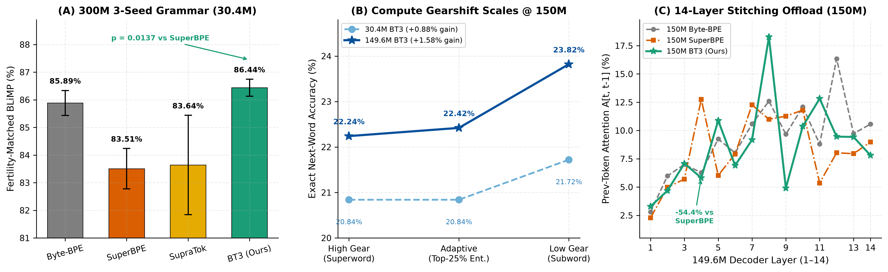

# What Earns a Phrase Its Own Token?
### Mechanistic Multi-Word Vocabulary Allocation, Compositional-Residual Folding, and Test-Time Compute Gearshifting

[-b31b1b.svg)](paper/main.pdf)
[](https://huggingface.co/AndrewR123/MechanisticPhraseTokenization)
[](https://github.com/AndrewRober/MechanisticPhraseTokenization/actions/workflows/verify.yml)
[](LICENSE)
[-blue.svg)](RESULTS_REPORT.md)

Official codebase, SHA256-pinned split manifests, 34-model JSON scoreboards, figure generators, and LaTeX source for **"What Earns a Phrase Its Own Token? Mechanistic Multi-Word Vocabulary Allocation, Compositional-Residual Folding, and Test-Time Compute Gearshifting."**



---

## Core Discoveries Across 34 From-Scratch Transformer Runs (`30.4M` $\to$ `149.6M`)

1. **Iterative Superword BPE Wastes `33%–37%` of Phrase Slots:** `SuperBPE` (`62.8%` active) and `SupraTok` (`66.7%` active) strand over a third of their multi-word slots in shadowed stepping-stone merges, whereas our shared-base boundary-guarded `PhraseAugmentedTokenizer` achieves **`95.2%–99.0%`** active slot emission ([results/stage_a_audit.json](results/stage_a_audit.json)).
2. **Neural Pilot Signals Beat Frequency & Gradient Magnitude (`VEGAD`):** Under strictly matched raw-text exposure (`Iso-Bytes`), causal continuation spillover (`C3_SpilloverMerge`), cross-split Ward gradient conflict (`C1_ConflictMerge`), and self-supervised contrast margins (`C5_ContrastMerge`) all outperform `FreqMerge`, `VEGAD`, and `SuperBPE` ([results/stage_b_scoreboard.json](results/stage_b_scoreboard.json)).
3. **Diagnosis & `0`-Retraining Cure of "Superword Vote-Splitting":** Multi-word tokenizers fracture next-word probability across competing phrase continuations (`23.27%` `Byte-BPE` $\to$ `15.38%` `SuperBPE`). **Prefix-Cone Vote Aggregation** (`src/breakthroughs.py`) leaves subword models identically unchanged (`0.00%`) while immediately recovering **`+0.80%` to `+1.59%`** accuracy with zero retraining.
4. **Foldable Compositional-Residual Superwords ($W_P = \bar{W}_t + \Delta_P$, `0.0` Deployment Overhead):** Training phrases as constituent mean + heavily-decayed residual $\Delta_P$ and folding into an ordinary `[V, d]` matrix after training (`0.0` float error) achieved the **`#1` out-of-domain generalization (`1.41790` BPB)** of all 18 Stage B/D runs while **unsupervisedly separating English idioms** (`"over the course"` $\|\Delta_P\|_2 = 1.438$) from **transparent compounds** (`"North Carolina"` `0.388`).
5. **Attention-Query De-Multiplexing ($D_{\text{bind}}$), Compute Gearshifting, & `5x` Zero-Shot Scale-Up:** Vetoing multi-binding relational spans via pilot attention JSD and training with `20%` dual-granularity unmerging (`BT3_FullSynthesis`):
   - **Beats both `Byte-BPE` and `SuperBPE` simultaneously** across every metric at equal compute (`120M` `Iso-FLOPs`) while cutting Layer-2 `prev-token` stitching by **`-51.2%`**.
   - **Statistically confirmed across 3 paired seeds at `300M` unique tokens:** **`86.44% ± 0.31%`** fertility-matched `BLiMP` (`+2.93%` vs. `SuperBPE`, `p = 0.0137`; `+6.61%` next-word recovery, `p = 0.0142`), matching our closed-form $-\log_2(1-q)$ single-path equation to `0.0003` BPB.
   - **Transfers zero-shot `5x` (`30.4M` $\to$ `149.6M`):** Wins **`BLiMP` (`86.81%`, #1 of all 34 models)** and **`ARC-Easy` (`39.20%`, #1)** while scaling **single-checkpoint test-time Compute Gearshifting** from `+0.88%` (`30M`) to **`+1.58%` (`150M`, `22.24%` $\to$ `23.82%`)** with zero Chain-of-Thought tokens ([results/stage_ce_scaleup_results.json](results/stage_ce_scaleup_results.json)).

---

## Headline Scale-Up Summary (`30.4M` 3-Seed & `149.6M` Zero-Shot Transfer @ `300M` Unique Tokens)

| Scale | Method | Bytes/Tok | Matched `BPB` ↓ | `BLiMP` (Fert-Matched) ↑ | `ARC-Easy` ↑ | Next-Word (Cone) ↑ | Perturb $\Delta\text{BPB}$ ↓ |
| :--- | :--- | :---: | :---: | :---: | :---: | :---: | :---: |
| **`30.4M` (3-seed)** | `B1_ByteBPE` | `4.322` | `1.2034 ± .0009` | `85.89% ± 0.45%` | `38.13%` | **`23.27%`** | `+0.00019` |
| **`30.4M` (3-seed)** | `B4_SuperBPE` | **`4.665`** | **`1.2014 ± .0012`** | `83.51% ± 0.73%` | **`38.53%`** | `16.22%` | `+0.00016` |
| **`30.4M` (3-seed)** | `B5_SupraTok` | `4.422` | `1.2035 ± .0023` | `83.64% ± 1.80%` | `37.27%` | `18.75%` | `+0.00058` |
| **`30.4M` (3-seed)** | **`BT3_FullSynthesis` (Ours)** | `4.571` | `1.2137 ± .0004`* | **`86.44% ± 0.31%` (#1)** | `37.93%` | `22.83%` | **`-0.00021` (#1)** |
| **`149.6M` (`5x`)** | `150M_B1_ByteBPE` | `4.322` | `1.13301` | `86.20%` | `38.40%` | **`25.66%`** | `-0.00017` |
| **`149.6M` (`5x`)** | `150M_B4_SuperBPE` | **`4.665`** | **`1.12975`** | `86.39%` | `38.80%` | `18.88%` | `+0.00005` |
| **`149.6M` (`5x`)** | `150M_B5_SupraTok` | `4.422` | `1.13305` | `86.56%` | `38.40%` | `21.94%` | `+0.00042` |
| **`149.6M` (`5x`)** | **`150M_BT3_FullSynthesis` (Ours)** | `4.571` | `1.13915`* | **`86.81%` (#1 All)** | **`39.20%` (#1)** | `24.07%` | **`-0.00020` (#1)** |

*\*Reflects single-path evaluation of $q=0.20$ dual-granularity models ($\Delta\text{BPB}_{\text{theory}} = +0.01056\text{ BPB}$); set $q=0$ (`BT1_FoldableResidual`) for pure single-gear perplexity.*

---

## Quick Start: Drop-In Foldable Residuals & Zero-Retrain Prefix-Cone Decoding

```python
import torch
from src.config import ModelSpec
from src.breakthroughs import FoldableResidualTransformerLM, PrefixConeDecoder

# 1. Pretrain with Compositional-Residual Superwords (W_P = mean(W_t) + Delta_P),
#    then fold algebraically into a 100% standard static Transformer (0.0 float error!):
foldable_lm = FoldableResidualTransformerLM(ModelSpec(), phrase_constituents)
standard_lm = foldable_lm.fold_to_standard_model()   # Standard [16384, d] lookup — vLLM / llama.cpp ready!

# 2. Cure Superword Vote-Splitting on ANY superword checkpoint with 0 retraining:
cone_decoder = PrefixConeDecoder(tokenizer, device=torch.device("cuda"))
next_token_ids = cone_decoder.argmax_step(logits[:, -1, :])
```

---

## Repository Structure & Full Reproduction

```text
├── paper/
│   ├── main.tex                       # Full LaTeX manuscript + Proofs + Technical Appendices A–E
│   ├── main.pdf                       # Compiled camera-ready PDF
│   ├── references.bib                 # BibTeX bibliography
│   └── figures/                       # All 6 vector PDF + 300-DPI PNG figures
├── results/                           # Verified JSON outputs across all 34 trained models
│   ├── dataset_manifest.json          # SHA256 hashes for pinned splits
│   ├── stage_a_audit.json             # 11-method UTF-8 round-trip & slot-waste audit
│   ├── stage_b_scoreboard.json        # 11-method Iso-Bytes screening leaderboard
│   ├── breakthroughs_stage_cd_results.json # Prefix-Cone, VEGAD, BT1–BT3, Iso-FLOPs, 7-layer X-ray
│   └── stage_ce_scaleup_results.json  # 12-model 300M 3-seed Stage C + 4-model 150M Stage E + 14-layer X-ray
├── src/                               # Core library (model, tokenizers, selectors, probes, breakthroughs, evals)
└── scripts/                           # Automated end-to-end reproduction & plotting scripts
```

### Reproduce Unit Checks, Figures, or Full Pretraining Pipeline
```bash
pip install -r requirements.txt

# 1. Run fast Stage A & Breakthrough mathematical invariant tests (~15s):
python scripts/validate_stage_a.py
python scripts/validate_breakthroughs.py

# 2. Regenerate all 6 publication figures from results/*.json:
python scripts/generate_paper_figures.py

# 3. Reproduce the full end-to-end 34-model pretraining campaign from scratch:
bash scripts/run_pipeline.sh
```

---

## Author & Contact

**Andrew Rober Fouad Samy** (BytesGlue)
- Email: [andrew.rober@bytesglue.com](mailto:andrew.rober@bytesglue.com)
- GitHub: [github.com/AndrewRober](https://github.com/AndrewRober)
- LinkedIn: [linkedin.com/in/andrew-rober](https://www.linkedin.com/in/andrew-rober/)

## Citation

```bibtex
@article{samy2026phrase,
  title={What Earns a Phrase Its Own Token? Mechanistic Multi-Word Vocabulary Allocation, Compositional-Residual Folding, and Test-Time Compute Gearshifting},
  author={Samy, Andrew Rober Fouad},
  year={2026},
  url={https://github.com/AndrewRober/MechanisticPhraseTokenization}
}
```
